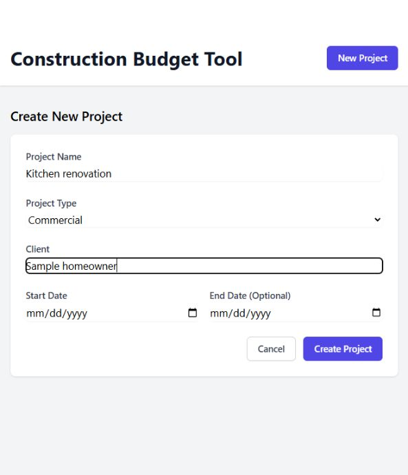

# Construction Budget Tool

A full-stack project-management foundation for tracking construction work. It gives residential and commercial projects a consistent home for client details, project types, and schedules.

*The project creation interface with illustrative, unsaved sample values.*

## What it does

- Project creation and editing forms.
- Project list with edit and delete workflows.
- Client, project type, start date, and end date fields.
- Typed API requests and React Query cache updates.
- Express REST endpoints, Zod validation, and PostgreSQL schema.

## Built with

React · TypeScript · Vite · Tailwind CSS · React Query · Express · PostgreSQL

## Run locally

Install dependencies separately in `server/` and `client/`. Configure `DATABASE_URL` for your PostgreSQL database. In `server/`, run `npm run db:migrate` and `npm run dev`; in a second terminal, run `npm run dev` from `client/`.

## Code guide

`client/src/components/` contains project views and forms. `server/src/` separates routes, controllers, models, validation types, and database setup.
